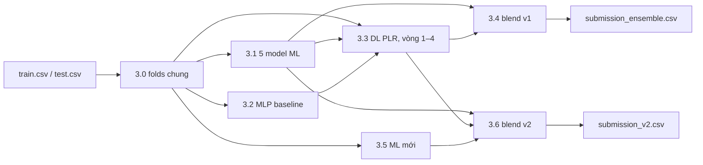

# Kết hợp ML + DL cho phát hiện gian lận thẻ (3.0–3.6)

Tài liệu của nhánh `ML_DL_ensemble`. Nhánh này gộp phần Machine Learning (nhánh `ML_Hieu`) với phần Deep Learning (nhánh `DL`) cho cuộc thi Kaggle Playground Series S6E11 (Credit Card Fraud, chấm bằng ROC-AUC). Tài liệu mô tả cách tiếp cận, từng notebook, code dùng chung, kết quả, cách chạy lại trên Kaggle và các giới hạn đã biết.

Mọi số liệu dưới đây lấy từ các file trong [results/](results/), do các notebook ghi ra khi chạy trên Kaggle. Báo cáo dạng tường thuật nằm ở [reports/task_3_ensemble.md](../reports/task_3_ensemble.md).

## Mục lục

1. [Kết quả tóm tắt](#1-kết-quả-tóm-tắt)
2. [Bối cảnh: vì sao phải làm lại nền tảng chung](#2-bối-cảnh-vì-sao-phải-làm-lại-nền-tảng-chung)
3. [Cấu trúc thư mục](#3-cấu-trúc-thư-mục)
4. [Nguyên tắc đánh giá](#4-nguyên-tắc-đánh-giá)
5. [Pipeline tổng thể](#5-pipeline-tổng-thể)
6. [Chi tiết từng notebook](#6-chi-tiết-từng-notebook)
7. [Code dùng chung](#7-code-dùng-chung)
8. [Kết quả chi tiết](#8-kết-quả-chi-tiết)
9. [Chạy lại trên Kaggle](#9-chạy-lại-trên-kaggle)
10. [Những gì rút ra được](#10-những-gì-rút-ra-được)
11. [Giới hạn và lỗi đã biết](#11-giới-hạn-và-lỗi-đã-biết)
12. [Hướng tiếp theo](#12-hướng-tiếp-theo)
13. [Tài liệu tham khảo](#13-tài-liệu-tham-khảo)

## 1. Kết quả tóm tắt

| Submission | CV (AUC trung bình theo fold) | Public LB |
|---|---:|---:|
| DL task 2.5: MLP one-hot, holdout 80/20 | 0.94462 (holdout) | 0.94263 |
| ML task 1.5: shallow GBDT + Spline LR | 0.94792 (OOF) | 0.94918 |
| ML-only trên folds chung (3.4) | 0.94784 | 0.94930 |
| Ensemble v1: 5 ML + 4 DL (3.4) | 0.94852 | 0.94972 |
| **Ensemble v2: 15 model (3.6)** | **0.94877** | **0.94988** |

- So với ML task 1.5, pipeline kết hợp tăng **+0.00070** trên public LB.
- Trên CV, v1 tăng +0.00068 so với ML-only, v2 tăng thêm +0.00024 so với v1. Cả hai lần đều **thắng ở 5/5 fold**.
- Mô hình DL tốt nhất (`mlp_plr_sig3_reg_x5`, OOF 0.94750) gần ngang LightGBM tốt nhất (`lgb_nl3_cnt`, 0.94787). Trong ensemble v2, các model DL chiếm khoảng **45% trọng số**.
- Điểm LB chỉ được ghi lại sau khi đã chọn phương án. Không có lựa chọn nào dựa trên LB.

## 2. Bối cảnh: vì sao phải làm lại nền tảng chung

Hai nhánh ban đầu không kết hợp được với nhau:

| | Nhánh ML (`ML_Hieu`) | Nhánh DL (`DL`) |
|---|---|---|
| Mô hình | LightGBM 3/4/8 lá, XGBoost depth 3, Spline LR, rank blend | MLP 128→64 trên one-hot |
| Đánh giá | `StratifiedKFold(5, shuffle=True, random_state=9)` | Một lần chia holdout 80/20 |
| Dự đoán out-of-fold | Có, cho toàn bộ train | Không có |
| Public LB | 0.94918 | 0.94263 |

Muốn blend hoặc stack, mọi model phải có dự đoán out-of-fold (OOF) **trên cùng một cách chia fold**. Nếu không, không thể so sánh công bằng và không thể học trọng số kết hợp mà không rò rỉ dữ liệu. Nhánh ML cũng từng thử co-training với pseudo-label cố định (`run_co_training.py`), nhưng kết quả kém hơn (LB 0.94795).

Nhánh `ML_DL_ensemble` được tạo từ `DL`. Các file code của `ML_Hieu` được lấy riêng vào [1.ML/src/](../1.ML/src/). Không merge thẳng vì `ML_Hieu` xóa thư mục dữ liệu và thư mục DL.

## 3. Cấu trúc thư mục

```
1.ML/src/                      code gốc của nhánh ML (task 1.1–1.5, co-training)
2.DL/                          code và kết quả của nhánh DL (task 2.1–2.5)
3.ENSEMBLE/
  README.md                    tài liệu này
  src/                         7 notebook Kaggle, chạy theo thứ tự 3.0 → 3.6
  results/                     metrics từng model, bảng so sánh, trọng số blend
shared/
  features.py                  đọc dữ liệu, feature, folds, rank/blend, đọc ghi dự đoán
  dl.py                        vòng huấn luyện PyTorch, PLR embedding, các kiến trúc DL
  ml.py                        hàm fit LightGBM / XGBoost / Logistic Regression / CatBoost
  folds/folds_5_seed9.csv      5 fold dùng chung (id, fold)
  splits/split_ids_seed9.csv   holdout 80/20 cũ của nhánh DL (không dùng ở phần 3)
submissions/
  submission_ml_only.csv       ML-only trên folds chung (LB 0.94930)
  submission_ensemble.csv      ensemble v1 (LB 0.94972)
  submission_v2.csv            ensemble v2 (LB 0.94988)
reports/task_3_ensemble.md     báo cáo chi tiết
```

File dự đoán OOF và test của từng model (`3.ENSEMBLE/oof/*.csv`, `3.ENSEMBLE/test/*.csv`) nằm trong output của các notebook trên Kaggle. Chúng không được đưa vào git vì mỗi file vài MB và có thể tạo lại từ notebook.

## 4. Nguyên tắc đánh giá

### 4.1 Folds chung

- File [shared/folds/folds_5_seed9.csv](../shared/folds/folds_5_seed9.csv) gồm hai cột `id, fold`, tạo bằng `StratifiedKFold(5, shuffle=True, random_state=9)` trên thứ tự gốc của `train.csv`.
- Notebook 3.0 kiểm tra file này **trùng từng dòng** với splitter của ML task 1.3–1.5. Nhờ vậy kết quả cũ của nhánh ML so sánh được trực tiếp.
- Mỗi fold có khoảng 139.992 dòng. Tỷ lệ gian lận ≈ 1,67% ở mọi fold.

### 4.2 Quy ước đầu ra của mọi model

Mỗi model, dù ML hay DL, ghi đúng 3 file qua `F.save_predictions`:

| File | Nội dung |
|---|---|
| `3.ENSEMBLE/oof/<tên>.csv` | `id, pred` cho 699.960 dòng train; mỗi dòng được dự đoán bởi model không thấy nó khi huấn luyện |
| `3.ENSEMBLE/test/<tên>.csv` | `id, pred` cho 299.984 dòng test; trung bình của 5 model fold (và của các seed, nếu có) |
| `3.ENSEMBLE/results/<tên>_metrics.json` | OOF AUC, AP, AUC từng fold, trung bình và độ lệch chuẩn theo fold, cấu hình |

Trước khi ghi, hàm kiểm tra độ dài, id không trùng và không có giá trị NaN hay vô cực. Khi đọc lại, `F.load_predictions` căn mọi file theo `id` và báo lỗi nếu thiếu id.

### 4.3 Hai cách đo AUC

- **OOF AUC**: tính trên toàn bộ OOF ghép lại.
- **AUC trung bình theo fold**: tính trên từng fold rồi lấy trung bình.

Với DL, hai số này có thể lệch nhau. Ví dụ `mlp_plr_sig3` có OOF 0.94431 nhưng trung bình theo fold 0.94588. Lý do là 5 model fold có thang xác suất hơi khác nhau, nên khi ghép OOF lại thì thứ tự giữa các fold bị xáo. Vì vậy:

- Khi blend, dùng **AUC trung bình theo fold** làm thước đo.
- Có thêm phương án rank OOF **trong từng fold** (`foldrank`).

### 4.4 Nested CV cho bước kết hợp

Trọng số blend hoặc meta-model được học trên 4 fold và chấm trên fold còn lại, lặp 5 lần. Nếu học và chấm trên cùng OOF, kết quả sẽ lạc quan. Sau khi chọn được phương án, trọng số được học lại trên toàn bộ OOF để áp lên test.

### 4.5 Quy tắc chọn (selection gate)

Phương án mới chỉ thay phương án cũ khi thỏa cả hai điều kiện:

1. AUC trung bình theo fold cao hơn.
2. Thắng phương án cũ ở **ít nhất 4/5 fold**.

Các mức gain ở đây chỉ khoảng 0.0001–0.0007, cùng cỡ với nhiễu, nên cần bằng chứng là cải thiện ổn định.

### 4.6 Không dùng leaderboard để chọn

Public LB chỉ tính trên một phần test. Chọn theo LB dễ overfit phần đó. LB được dùng như một kiểm tra độc lập: cả v1 và v2 đều tăng trên LB cùng chiều với CV.

## 5. Pipeline tổng thể



Mỗi mũi tên là một input trên Kaggle: output của notebook trước được gắn vào notebook sau.

## 6. Chi tiết từng notebook

### 3.0 — Folds chung ([3-0-shared-folds.ipynb](src/3-0-shared-folds.ipynb))

| | |
|---|---|
| Mục đích | Tạo `folds_5_seed9.csv` và chứng minh nó trùng splitter của ML |
| Input | Dữ liệu cuộc thi, dataset `ccf-shared-code` |
| Accelerator | None |
| Output | `folds_5_seed9.csv` |
| Kiểm tra | Đủ 699.960 id, 5 fold, tỷ lệ gian lận mỗi fold ≈ 1,67%, trùng từng dòng với `StratifiedKFold` của task 1.3–1.5 |

### 3.1 — 5 model ML trên folds chung ([3-1-ml-models-shared-folds.ipynb](src/3-1-ml-models-shared-folds.ipynb))

Chạy lại đúng cấu hình ML task 1.5, đọc fold từ file chung và ghi riêng OOF/test của từng model.

| Model | Feature | Cấu hình chính | OOF AUC |
|---|---|---|---:|
| `lgb_nl3` | `tree_frame` (gốc + 9 feature thêm) | 3 lá, lr 0.06, L2 10, min_child 200, early stop 150 | 0.94774 |
| `lgb_nl4` | như trên | 4 lá, feature_fraction 0.7 | 0.94758 |
| `lgb_nl8` | như trên | 8 lá, lr 0.04, L2 30, L1 1 | 0.94720 |
| `xgb` | `codes_frame` | depth 3, eta 0.06, L2 10 | 0.94730 |
| `spline_lr` | `LinearFE` (spline + one-hot) | Logistic Regression C = 0.1 | 0.94469 |

Kiểm tra tái lập: rank blend 5 model đạt OOF **0.94789**, so với 0.94792 của task 1.5 ([ml_blend_check.json](results/ml_blend_check.json)).

- Input: dữ liệu cuộc thi, `ccf-shared-code`, output 3.0.
- Accelerator: None.

### 3.2 — MLP baseline 5-fold ([3-2-mlp-baseline-5fold.ipynb](src/3-2-mlp-baseline-5fold.ipynb))

Đưa MLP của task 2.1 (StandardScaler + one-hot, 128→64, dropout 0.2/0.1) vào vòng 5-fold. Bộ tiền xử lý được fit trong từng fold.

- Kết quả: `mlp_base` OOF **0.94256**, thấp hơn holdout cũ (0.94462). Holdout 80/20 là một phép chia dễ hơn trung bình.
- Input: dữ liệu cuộc thi, `ccf-shared-code`, output 3.0.
- Accelerator: GPU T4.

### 3.3 — Nâng cấp DL ([3-3-dl-upgrades.ipynb](src/3-3-dl-upgrades.ipynb))

MLP baseline thua cả Spline LR, nên nút thắt nằm ở cách biểu diễn cột số. Notebook chạy theo vòng, mỗi vòng là một phiên bản notebook trên Kaggle.

| Vòng | Thí nghiệm | OOF AUC | Kết luận |
|---|---|---:|---|
| 1 | `mlp_fe`: MLP one-hot + 9 feature của ML | 0.94225 | Thêm feature không giúp |
| 1 | `mlp_plr`: PLR, σ = 0.1 | 0.94332 | σ quá nhỏ, PLR gần như tuyến tính |
| 1 | `mlp_plr_sig1`: σ = 1 | 0.94516 | PLR có tác dụng |
| 2 | `mlp_plr_sig3`: σ = 3 | 0.94431 | Khác LGBM nhiều hơn |
| 2 | `mlp_plr_sig1_reg`: σ = 1 + regularization | 0.94578 | |
| 2 | `mlp_plr_sig3_reg`: σ = 3 + regularization | 0.94544 | Gain blend tốt nhất vòng 2 |
| 3 | `mlp_plr_sig10_reg`: σ = 10 | 0.94355 | AUC riêng giảm nhiều |
| 3 | `mlp_plr_sig3_reg_x3`: 3 seed | 0.94707 | Seed averaging +0.0016 |
| 4a | `mlp_plr_sig3_reg_x5`: 5 seed | **0.94750** | DL đơn tốt nhất |
| 4a | `mlp_plr_sig3_x3`, `mlp_plr_sig10_reg_x3` | 0.94711 / 0.94602 | |
| 4b | `mlp_plr_sig2_reg`, `mlp_plr_sig5_reg` | 0.94595 / 0.94548 | σ = 5 cho gain blend cao nhất |
| 4b | `resnet_plr_sig3`: Tabular ResNet head | 0.94281 | Yếu, gain nhỏ |

**Kiến trúc `EmbeddingMLP`** (trong [shared/dl.py](../shared/dl.py)):

- **22 cột số** (8 liên tục + 5 rời rạc + 9 feature thêm của ML):
  - QuantileTransformer về phân phối chuẩn, fit trong từng fold.
  - **PLR embedding**: với mỗi cột x, tính sin và cos của 2π·c·x với 16 tần số c học được (khởi tạo theo N(0, σ²)), rồi qua một lớp Linear riêng cho từng cột (32 → 16) và ReLU. Kết quả là 352 chiều.
- **6 cột boolean** giữ dạng 0/1.
- **10 cột category** (5 category + 5 cột rời rạc): mỗi cột một `nn.Embedding`, số chiều min(16, max(2, ⌈√(K+1)⌉)), mã 0 dành cho giá trị chưa gặp ở train.
- **Head**: MLP 256 → 128 → 1, hoặc Tabular ResNet (2 khối residual, d = 256).

**Cấu hình huấn luyện:**

| | `PLR_CFG` | `REG_CFG` (hậu tố `_reg`) |
|---|---|---|
| Optimizer | AdamW, weight decay 1e-4 | AdamW, weight decay 1e-2 |
| Learning rate | OneCycle, max 2e-3 | OneCycle, max 1e-3 |
| Batch, số epoch | 1024, 12 | 1024, 10 |
| Dropout | 0.15 / 0.10 | 0.30 / 0.20 |
| Chọn checkpoint | Epoch có AUC validation cao nhất (`patience` = số epoch, nên không dừng sớm) | như bên trái |
| Khác | Gradient clipping 1.0, không dùng `pos_weight` | như bên trái |

**Seed:**
- Seed của mỗi lần train là `seed·100 + fold`.
- Bản `_x3` và `_x5` là trung bình xác suất của 3 và 5 seed.
- Ô *merge* ghép các lần chạy bằng trung bình có trọng số theo số seed. Ví dụ x5 = (3·x3 + 2·bản 2 seed) / 5, giống hệt chạy lại 5 seed.

**Cách chạy:**
- Biến `ROUND` chọn vòng (`"4a"`, `"4b"`).
- Ô cuối chép dự đoán của các phiên bản trước vào output, để phiên bản mới nhất chứa đủ mọi model DL.
- Ô so sánh ghi [dl_vs_ml_3_3.csv](results/dl_vs_ml_3_3.csv) với ba thông tin cho mỗi model DL: AUC, tương quan Spearman với `lgb_nl3`, và gain khi blend với 5 model ML (alpha chọn trên 4 fold, chấm trên fold còn lại).

**Input và accelerator:**
- Input: dữ liệu cuộc thi, `ccf-shared-code`, output 3.0, 3.1, 3.2 và phiên bản trước của chính 3.3.
- Accelerator: GPU T4.

### 3.4 — Blend v1 và submission ([3-4-blend-and-submission.ipynb](src/3-4-blend-and-submission.ipynb))

| Phương án | Mô tả | AUC theo fold | Gain so với ML-only | Thắng |
|---|---|---:|---:|---:|
| `ml_only` | 5 ML, rank blend | 0.94784 | — | — |
| `ml+dl_best` | 5 ML + `sig3_reg_x3` | 0.94839 | +0.00055 | 5/5 |
| **`ml+dl_all`** | **5 ML + 4 DL PLR** | **0.94852** | **+0.00068** | **5/5** |
| `stack_lr` | Logistic Regression trên logit 9 model | 0.94850 | +0.00066 | 5/5 |

Trọng số của `ml+dl_all`, học lại trên toàn bộ OOF ([final_blend.json](results/final_blend.json)):

| lgb_nl3 | lgb_nl4 | lgb_nl8 | spline_lr | xgb | sig3_reg_x3 | sig1_reg | sig3 | sig10_reg |
|---:|---:|---:|---:|---:|---:|---:|---:|---:|
| 0.191 | 0.181 | 0.076 | 0.033 | 0.100 | 0.186 | 0.033 | 0.098 | 0.102 |

Notebook ghi hai file: `submission_ensemble.csv` (phương án được chọn) và `submission_ml_only.csv` (để đối chiếu).

- Input: dữ liệu cuộc thi, `ccf-shared-code`, output 3.0, 3.1 và phiên bản mới nhất của 3.3.
- Accelerator: None.

### 3.5 — Model ML mới ([3-5-ml-new-models.ipynb](src/3-5-ml-new-models.ipynb))

| Model | Thay đổi | OOF AUC | Gain khi thêm vào v1 |
|---|---|---:|---:|
| `lgb_nl3_cnt` | `lgb_nl3` + 13 feature đếm tần suất giá trị (đếm trên train + test, không dùng nhãn) | **0.94787** | **+0.00009** |
| `lgb_nl3_x3` | `lgb_nl3`, trung bình 3 seed | 0.94784 | 0 |
| `lgb_nl4_x3` | `lgb_nl4`, trung bình 3 seed | 0.94782 | ≈ 0 |
| `catboost_d4` | CatBoost depth 4, category khai báo trực tiếp | 0.94662 | ≈ 0 |
| `catboost_d6` | CatBoost depth 6 | 0.94613 | ≈ 0 |

Gain được đo bằng `F.cv_alpha_gain` ([ml_new_vs_v1_3_5.csv](results/ml_new_vs_v1_3_5.csv)): blend ensemble v1 với model mới, alpha chọn trên 4 fold và chấm trên fold còn lại.

**Chạy CatBoost bằng GPU:**
- Biến `MODELS` cho phép tách lần chạy. CatBoost tự dùng GPU khi notebook bật GPU (`CB_TASK`).
- Khi chạy bằng GPU, output được lưu với hậu tố `_gpu` để không trùng tên với bản CPU.
- Bản GPU chưa được chạy.

**Input, accelerator và thời gian:**
- Input: dữ liệu cuộc thi, `ccf-shared-code` (có `ml.py`), output 3.0, 3.1 và phiên bản mới nhất của 3.3.
- Accelerator: None.
- Thời gian: khoảng 3,5 giờ trên CPU, phần lớn cho CatBoost (khoảng 14 phút mỗi fold với depth 6).

### 3.6 — Blend v2 và submission ([3-6-blend-v2-and-submission.ipynb](src/3-6-blend-v2-and-submission.ipynb))

**Ứng viên:**
- 9 model của v1 và các model mới có output.
- Bản nhiều seed thay bản ít seed của cùng cấu hình: `lgb_nl3` → `lgb_nl3_x3`, `lgb_nl4` → `lgb_nl4_x3`, `sig3_reg_x3` → `sig3_reg_x5`, `sig3` → `sig3_x3`, `sig10_reg` → `sig10_reg_x3`.
- Tổng cộng **15 model**.

| Phương án | Mô tả | AUC theo fold | AP | Gain so với v1 | Thắng v1 |
|---|---|---:|---:|---:|---:|
| `v1` | Tái lập `ml+dl_all` của 3.4 | 0.94852 | 0.5203 | — | — |
| `rw_all` | Random walk + shrink, rank toàn cục | 0.94875 | 0.5217 | +0.00023 | 5/5 |
| **`rw_all_foldrank`** | **Như trên, rank trong từng fold** | **0.94877** | 0.5217 | **+0.00024** | **5/5** |
| `stack_lr_all` | Logistic Regression trên logit 15 model | 0.94876 | 0.5221 | +0.00023 | 4/5 |
| `hill_all_foldrank` | Hill climbing (Caruana) | 0.94866 | 0.5213 | +0.00014 | 4/5 |

Phương án được chọn là `rw_all_foldrank`. Ba phương án đứng đầu chỉ chênh nhau khoảng 0.00002, nên gain không phụ thuộc vào cách blend. Hàng `v1` ra đúng 0.94852 như ở 3.4, xác nhận mốc được tái lập chính xác.

Trọng số cuối ([final_blend_v2.json](results/final_blend_v2.json)):

| Nhóm | Model và trọng số |
|---|---|
| ML (≈ 0.55) | `lgb_nl3_cnt` 0.260, `xgb` 0.062, `lgb_nl3_x3` 0.060, `catboost_d4` 0.057, `lgb_nl4_x3` 0.046, `lgb_nl8` / `spline_lr` / `catboost_d6` 0.020 mỗi model |
| DL (≈ 0.45) | `mlp_plr_sig5_reg` 0.151, `mlp_plr_sig3_reg_x5` 0.147, `mlp_plr_sig10_reg_x3` 0.065, `resnet_plr_sig3` 0.029, `mlp_plr_sig3_x3` 0.023, `sig1_reg` / `sig2_reg` 0.020 mỗi model |

Mức 0.020 là sàn do shrinkage (0.3 / 15), nghĩa là model đó gần như không được chọn.

**Các file notebook ghi ra:**
- `submission_v2.csv`.
- [blend_comparison_v2.csv](results/blend_comparison_v2.csv): so sánh 5 phương án.
- [single_models_v2.csv](results/single_models_v2.csv): AUC của từng model đơn.
- [final_blend_v2.json](results/final_blend_v2.json): phương án được chọn và trọng số.

**Input và accelerator:**
- Input: dữ liệu cuộc thi, `ccf-shared-code`, output 3.0, 3.1, phiên bản 4b của 3.3 và 3.5.
- Accelerator: None.

## 7. Code dùng chung

Các notebook chỉ chứa phần điều phối. Logic nằm trong `shared/` để mọi notebook dùng cùng một cách đọc dữ liệu, chia fold và ghi kết quả.

### 7.1 [shared/features.py](../shared/features.py)

| Nhóm | Hàm / hằng | Việc làm |
|---|---|---|
| Hằng | `SEED`, `N_FOLDS`, `NUMS`, `BOOLS`, `CATS`, `DISCRETE`, `CONTINUOUS`, `DECIMAL_SCALES` | Danh sách cột và tham số chung |
| Dữ liệu | `find_file`, `load` | Tìm file trong `/kaggle/input` hoặc `data/`; đọc train/test, bool → 0/1, category dựng trên train + test |
| Feature | `add_extra_features`, `tree_frame`, `codes_frame`, `LinearFE`, `add_count_features` | 9 feature thêm của ML (`n_flags`, phần lẻ thập phân, tương tác), frame cho cây, frame mã hóa, spline cho LR, đếm tần suất |
| Folds | `make_folds`, `load_folds`, `iter_folds` | Tạo, đọc và duyệt 5 fold chung |
| Blend | `rank01`, `rank_within_folds`, `tune_weights`, `hill_climb`, `cv_alpha_gain` | Đổi sang rank, rank trong fold, tìm trọng số bằng random walk, Caruana, đo gain khi thêm một model |
| Metrics | `fold_metrics` | OOF AUC, AP, AUC từng fold |
| I/O | `save_predictions`, `find_prediction`, `load_predictions` | Ghi và đọc OOF/test theo quy ước, căn theo id |

### 7.2 [shared/dl.py](../shared/dl.py)

| Thành phần | Việc làm |
|---|---|
| `TrainConfig` | lr, weight decay, batch, số epoch, patience, scheduler, gradient clipping, `pos_weight` |
| `seed_everything` | Đặt seed cho Python, NumPy, PyTorch; bật cuDNN tất định |
| `train_fold` | Đưa toàn bộ train fold lên GPU, huấn luyện với AdamW + scheduler, đánh giá AUC mỗi epoch, giữ checkpoint tốt nhất |
| `predict` | Dự đoán theo batch ở chế độ `eval`, trả về xác suất |
| `MLP` | Linear → ReLU → Dropout lặp lại, đầu ra logit |
| `PeriodicEmbedding` | PLR embedding cho cột số |
| `ResNetHead` | Head Tabular ResNet |
| `EmbeddingMLP` | Ghép PLR + boolean + embedding category, rồi đưa vào head |
| `encode_categories` | Mã category theo train, 0 cho giá trị chưa gặp |

### 7.3 [shared/ml.py](../shared/ml.py)

Các hàm `fit_lgb`, `fit_xgb`, `fit_linear`, `fit_catboost` có cùng giao diện: nhận dữ liệu train, valid và test của một fold, rồi trả về `(dự đoán valid, dự đoán test, số vòng lặp)`. Ba hàm cho model cây dừng sớm khi AUC trên fold validation không tăng sau 150 vòng. Tham số nằm trong `LGB_BASE`, `LGB_CONFIGS` và `XGB_PARAMS`.

## 8. Kết quả chi tiết

### 8.1 Mọi model đơn

Số liệu từ các file `results/*_metrics.json`.

| Model | Loại | OOF AUC | AUC TB theo fold | Std theo fold | AP |
|---|---|---:|---:|---:|---:|
| `lgb_nl3_cnt` | ML | 0.94787 | 0.94787 | 0.00182 | 0.5163 |
| `lgb_nl3_x3` | ML | 0.94784 | 0.94785 | 0.00198 | 0.5168 |
| `lgb_nl4_x3` | ML | 0.94782 | 0.94782 | 0.00201 | 0.5159 |
| `lgb_nl3` | ML | 0.94774 | 0.94775 | 0.00190 | 0.5156 |
| `lgb_nl4` | ML | 0.94758 | 0.94757 | 0.00202 | 0.5139 |
| `mlp_plr_sig3_reg_x5` | DL | 0.94750 | 0.94763 | 0.00165 | 0.5163 |
| `xgb` | ML | 0.94730 | 0.94729 | 0.00208 | 0.5140 |
| `lgb_nl8` | ML | 0.94720 | 0.94722 | 0.00181 | 0.5130 |
| `mlp_plr_sig3_x3` | DL | 0.94711 | 0.94732 | 0.00170 | 0.5131 |
| `mlp_plr_sig3_reg_x3` | DL | 0.94707 | 0.94739 | 0.00170 | 0.5141 |
| `catboost_d4` | ML | 0.94662 | 0.94663 | 0.00196 | 0.5097 |
| `catboost_d6` | ML | 0.94613 | 0.94615 | 0.00172 | 0.5066 |
| `mlp_plr_sig10_reg_x3` | DL | 0.94602 | 0.94638 | 0.00189 | 0.5097 |
| `mlp_plr_sig2_reg` | DL | 0.94595 | 0.94674 | 0.00170 | 0.5085 |
| `mlp_plr_sig1_reg` | DL | 0.94578 | 0.94649 | 0.00196 | 0.5068 |
| `mlp_plr_sig5_reg` | DL | 0.94548 | 0.94610 | 0.00199 | 0.5052 |
| `mlp_plr_sig3_reg` | DL | 0.94544 | 0.94655 | 0.00189 | 0.5059 |
| `mlp_plr_sig1` | DL | 0.94516 | 0.94593 | 0.00230 | 0.5027 |
| `spline_lr` | ML | 0.94469 | 0.94470 | 0.00159 | 0.5008 |
| `mlp_plr_sig3` | DL | 0.94431 | 0.94588 | 0.00178 | 0.4993 |
| `mlp_plr_sig10_reg` | DL | 0.94355 | 0.94399 | 0.00188 | 0.4969 |
| `mlp_plr` (σ = 0.1) | DL | 0.94332 | 0.94465 | 0.00190 | 0.4941 |
| `resnet_plr_sig3` | DL | 0.94281 | 0.94366 | 0.00197 | 0.4993 |
| `mlp_base` | DL | 0.94256 | 0.94265 | 0.00171 | 0.4890 |
| `mlp_fe` | DL | 0.94225 | 0.94232 | 0.00174 | 0.4863 |

### 8.2 Gain của từng model DL khi blend với 5 model ML

Số liệu từ [dl_vs_ml_3_3.csv](results/dl_vs_ml_3_3.csv). Mốc ML-only: AUC theo fold 0.94790.

| Model DL | Spearman với `lgb_nl3` | Gain | Alpha (tỷ trọng DL) theo fold |
|---|---:|---:|---|
| `mlp_plr_sig5_reg` | 0.944 | **+0.00064** | 0.325–0.35 |
| `mlp_plr_sig10_reg_x3` | 0.944 | +0.00061 | 0.325–0.375 |
| `mlp_plr_sig3_reg_x5` | 0.971 | +0.00060 | 0.40–0.50 |
| `mlp_plr_sig3_reg_x3` | 0.967 | +0.00057 | 0.375–0.45 |
| `mlp_plr_sig3_x3` | 0.965 | +0.00054 | 0.375–0.45 |
| `mlp_plr_sig3_reg` | 0.955 | +0.00049 | 0.325–0.375 |
| `mlp_plr_sig3` | 0.940 | +0.00046 | 0.275–0.30 |
| `mlp_plr_sig2_reg` | 0.960 | +0.00041 | 0.30–0.35 |
| `mlp_plr_sig10_reg` | 0.926 | +0.00038 | 0.20–0.25 |
| `resnet_plr_sig3` | 0.904 | +0.00025 | 0.175–0.20 |
| `mlp_plr_sig1_reg` | 0.971 | +0.00012 | 0.20–0.25 |
| `mlp_base` | 0.942 | ≈ 0 | ≈ 0 |

### 8.3 Public LB

| File | Public LB |
|---|---:|
| `submission_ml_only.csv` | 0.94930 |
| `submission_ensemble.csv` (v1) | 0.94972 |
| `submission_v2.csv` (v2) | **0.94988** |

## 9. Chạy lại trên Kaggle

Toàn bộ phần 3 chạy trên Kaggle Notebook. Máy local không cần cài PyTorch hay LightGBM.

### 9.1 Chuẩn bị

1. Tạo một Kaggle Dataset tên `ccf-shared-code` chứa `features.py`, `dl.py`, `ml.py` từ thư mục `shared/`. Khi sửa code thì tạo phiên bản dataset mới.
2. Mỗi notebook có ô khởi động tự tìm `features.py` trong `/kaggle/input` và thêm thư mục đó vào `sys.path`. Vì vậy không cần sửa đường dẫn.
3. Import notebook qua **File → Import Notebook**, chọn file trong `3.ENSEMBLE/src/`.

### 9.2 Thứ tự chạy

| Bước | Notebook | Tên gợi ý trên Kaggle | Gắn thêm input (ngoài dữ liệu cuộc thi và `ccf-shared-code`) | Accelerator |
|---|---|---|---|---|
| 1 | 3.0 | `ccf-3-0-shared-folds` | — | None |
| 2 | 3.1 | `ccf-3-1-ml-models` | 3.0 | None |
| 3 | 3.2 | | 3.0 | GPU T4 |
| 4 | 3.3 | `ccf-3-3-dl-upgrades` | 3.0, 3.1, 3.2, phiên bản trước của 3.3 | GPU T4 |
| 5 | 3.4 | | 3.0, 3.1, 3.3 (mới nhất) | None |
| 6 | 3.5 | `ccf-3-5-ml-new` | 3.0, 3.1, 3.3 (mới nhất) | None (hoặc GPU cho CatBoost) |
| 7 | 3.6 | `ccf-3-6-blend-v2` | 3.0, 3.1, 3.3 (mới nhất), 3.5 | None |

Mỗi bước bấm **Save Version → Save & Run All**. Output của một phiên bản đã chạy xong mới dùng làm input cho bước sau được.

### 9.3 Lưu ý khi chạy

- **3.3 chạy nhiều lần**: đổi biến `ROUND` (ví dụ `"4a"` rồi `"4b"`). Mỗi lần là một phiên bản notebook, và phải gắn output của phiên bản trước làm input. Ô cuối chép các model cũ sang, nên phiên bản mới nhất luôn chứa đủ mọi model DL.
- **Không để trùng tên file giữa các input**: `find_prediction` báo lỗi khi thấy hai file `oof/<tên>.csv`. Đó là lý do 3.3 không chép `mlp_base`, và bản CatBoost GPU dùng hậu tố `_gpu`.
- **3.5 có thể tách**: sửa `MODELS` để chạy LGBM và CatBoost ở hai notebook. Không để một model xuất hiện ở hai notebook cùng được gắn vào 3.6.
- **Phiên GPU bị xếp hàng**: tắt các phiên editor đang giữ GPU.
- **Kiểm tra log của 3.6**: ô 4 in ra `Model mới có output` và `Model mới thiếu`. Nếu thiếu model đã chạy thì đang gắn nhầm phiên bản input.
- **Nộp bài**: tải `submission_v2.csv` từ tab Output của 3.6. File có 299.984 dòng, cột `id,is_fraud`, giá trị là rank trong [0, 1].

## 10. Những gì rút ra được

1. **Nền tảng đánh giá chung quan trọng hơn mô hình.** Khi chưa có folds chung và OOF, không thể biết DL có giúp ML hay không. Sau khi có, mỗi thay đổi đều đo được gain với độ ổn định theo fold.
2. **Với DL trên dữ liệu bảng, cách biểu diễn cột số là nút thắt.** Thêm feature vào MLP one-hot không giúp (0.94225). Thay biểu diễn bằng PLR giúp rõ (0.94256 → 0.94544, và 0.94750 khi có 5 seed).
3. **σ của PLR điều khiển mức khác biệt so với cây.** σ lớn cho AUC riêng thấp hơn nhưng tương quan với LGBM thấp hơn. Model tốt nhất để thêm vào ensemble không phải model đơn mạnh nhất (σ = 5 cho gain +0.00064, cao hơn σ = 3 với 5 seed).
4. **Seed averaging giúp DL nhưng không giúp LGBM nông.** Mạng nơ-ron có phương sai lớn giữa các seed (+0.0016 với 3 seed, +0.0021 với 5 seed). LGBM 3 lá gần như không đổi khi đổi seed (Spearman 0.9987).
5. **Feature đếm tần suất là cải tiến duy nhất có ích ở phía ML trong v2.** CatBoost yếu hơn LGBM và không mang thêm thông tin.
6. **Cách blend ít quan trọng hơn việc chọn model.** Random walk, stacking và rank trong fold cho kết quả gần như nhau (chênh khoảng 0.00002).

## 11. Giới hạn và lỗi đã biết

- **Gain nhỏ**: v1 +0.00068 trên CV, +0.00042 trên LB so với ML-only; v2 +0.00024 trên CV, +0.00016 trên LB so với v1. Public LB chỉ là một phần test, nên điểm private có thể khác.
- **Các nguồn lạc quan còn lại trong CV:**
  - Early stopping (ML) và chọn checkpoint (DL) dùng chính fold validation dùng để chấm OOF.
  - Cấu hình DL và danh sách model được chọn trên cùng OOF.
  - v2 chọn trong 15 model và 5 phương án blend.

  Nested CV chỉ loại phần lạc quan của bước học trọng số.
- **Tính tái lập của DL**: trong 3.3, `make_model()` được gọi trước khi `train_fold` đặt seed. Vì vậy trọng số khởi tạo không được điều khiển bởi seed, và chạy lại notebook sẽ cho kết quả gần nhưng không giống hệt. Cách sửa: gọi `D.seed_everything(s * 100 + f)` ngay trước `make_model()`. Code trong repo được giữ nguyên để khớp với kết quả đã nộp.
- **CatBoost GPU** đã có code nhưng chưa chạy.
- **Feature đếm tần suất dùng cả test** (không dùng nhãn). Cách này hợp lệ trong bối cảnh cuộc thi, nhưng với hệ thống thật thì phải đếm trên dữ liệu có sẵn tại thời điểm dự đoán.

## 12. Hướng tiếp theo

Theo thứ tự ưu tiên. Mỗi hướng ước tính thêm khoảng 0.0001 trên CV:

1. Thêm seed cho `mlp_plr_sig5_reg` và `mlp_plr_sig10_reg`, hai model DL cho gain blend cao nhất.
2. Đưa feature đếm tần suất vào DL và XGBoost.
3. Dùng OOF của GBDT làm input cho MLP, tính trong từng fold để không rò rỉ.
4. Pseudo-label tính trong từng fold, chỉ giữ nếu OOF tăng.
5. TabNet hoặc FT-Transformer trên folds chung.

## 13. Tài liệu tham khảo

- Gorishniy, Rubachev, Babenko (2022). *On Embeddings for Numerical Features in Tabular Deep Learning.* NeurIPS. PLR embedding.
- Gorishniy, Rubachev, Khrulkov, Babenko (2021). *Revisiting Deep Learning Models for Tabular Data.* NeurIPS. Tabular ResNet.
- Caruana, Niculescu-Mizil, Crew, Ksikes (2004). *Ensemble Selection from Libraries of Models.* ICML. Hill climbing.
- Wolpert (1992). *Stacked Generalization.* Neural Networks.
- Smith, Topin (2019). *Super-Convergence: Very Fast Training of Neural Networks Using Large Learning Rates.* One-cycle learning rate.
- Loshchilov, Hutter (2019). *Decoupled Weight Decay Regularization.* ICLR. AdamW.
